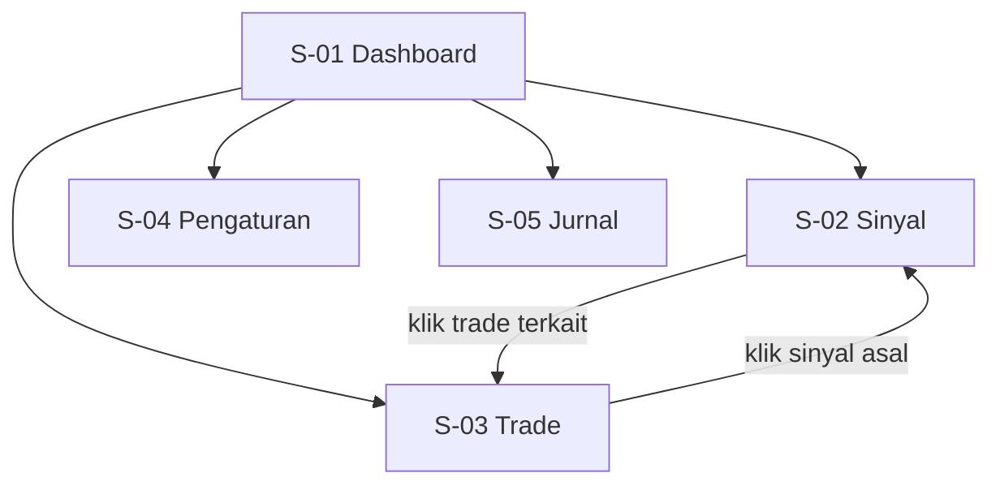
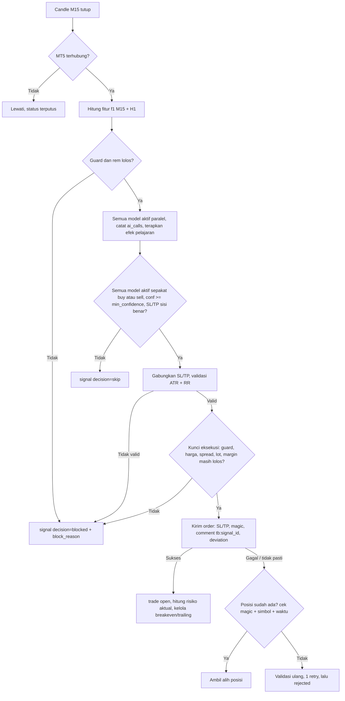
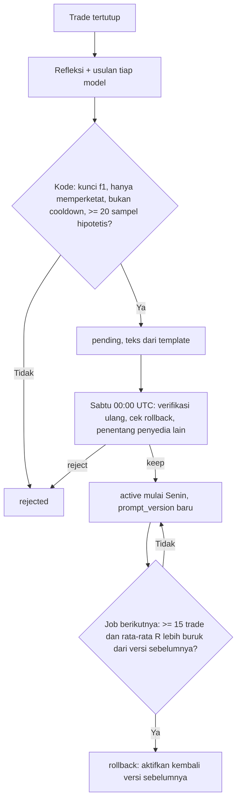

# AFD - TradingBot AI (MT5)

> Versi: 0.5 | Diperbarui: 2026-10-29 | Merujuk: PRD.md (ID fitur F-xx)

## 1. Peta Layar
| ID | Layar | Rute/URL | Akses | Fitur terkait |
|---|---|---|---|---|
| S-01 | Dashboard | `/` | Owner (localhost) | F-01, F-03, F-04, F-05, F-06, F-09 |
| S-02 | Sinyal & Opini AI | `/signals` | Owner | F-02, F-03, F-06, F-08 |
| S-03 | Posisi & Riwayat | `/trades` | Owner | F-05, F-06 |
| S-04 | Risiko & Pengaturan | `/settings` | Owner | F-03, F-04, F-06, F-08, F-09 |
| S-05 | Jurnal & Performa | `/journal` | Owner | F-06, F-07, F-08 |

## 2. Navigasi Utama
Bilah navigasi tetap di atas semua layar: Dashboard, Sinyal, Trade, Pengaturan, Jurnal. Kill switch selalu terlihat di header.

## 3. Alur Utama Bot (latar belakang)

Guard dan rem dicek dari yang paling murah: kill switch, rugi mingguan, jeda kalah beruntun, entry harian, cutoff Jumat, sesi, pasar tutup, posisi penuh, kalender usang/berita, spread, volatilitas, jumlah/diversitas model, model AI tidak sehat, anggaran panggilan AI. Blokir rutin hanya dicatat di `signals.block_reason`; `risk_events` hanya dicatat saat kondisi risiko mulai (dan selesai bila relevan).

## 4. Alur per Fitur

### F-01 Koneksi MT5 & data pasar
**Pemicu:** bot start (oleh watchdog), atau tiap siklus.
**Alur utama:**
1. Bot mengunci `data/bot.lock`; gagal mengunci berarti instans lain sudah berjalan -> keluar dengan pesan.
2. Lewat thread pekerja MT5, bot memanggil `initialize`, membaca info akun, dan memeriksa Algo Trading, tipe akun hedging, `filling_mode`, serta `symbol_map`.
3. Bot membandingkan tipe akun dengan `settings.mode` (penjaga live, TRD 5).
4. Tiap siklus mengambil >= 2000 candle M15 dan >= 1000 candle H1 per simbol; S-01 menampilkan status "terhubung", saldo, equity.

**Alur alternatif / gagal:**
- Terminal tidak berjalan -> status "terputus" (S-01), coba lagi tiap 10 detik (5 kali) lalu tiap 60 detik tanpa batas, catat `risk_events` (`broker_error`); terputus > 5 menit -> notifikasi F-09; trading lanjut otomatis saat tersambung.
- Algo Trading nonaktif, akun netting, atau `filling_mode` tidak didukung -> bot menolak start dengan pesan penyebab.
- Simbol belum terpetakan / tidak ditemukan -> bot menolak start; S-04 menampilkan kandidat dari MT5 (mis. `XAUUSDm`, `GOLD`) untuk dipilih dan disimpan ke `symbol_map`.
- Tipe akun tidak cocok dengan mode -> bot berhenti (`live_guard`).
- Ada posisi tanpa magic number bot (mis. trade manual) -> diabaikan, tidak diambil alih; tetap terhitung di equity.
- Jumlah candle kurang dari batas minimum -> lewati siklus simbol itu.

### F-02 Analisa teknikal & filter berita
**Pemicu:** setiap candle M15 tutup; pembaruan kalender tiap 6 jam.
**Alur utama:**
1. Hitung paket fitur `f1` (TRD 5c) untuk M15 dan H1 dari candle yang sudah tutup.
2. Cek tabel `news_events` dan `manual_blackouts`: ada event `impact = high` mata uang terkait dalam `± news_block_minutes`?
3. Fitur masuk ke paket untuk AI; kalau ada berita -> sinyal `blocked` (`news_block`).

**Alur alternatif / gagal:**
- Kalender gagal diambil / lebih tua dari 24 jam / tidak mencakup waktu sekarang -> blokir entry (`calendar_stale`), `risk_events` dicatat saat kondisi mulai.

### F-03 Panel multi-AI & konsensus
**Pemicu:** fitur lolos guard pada candle M15 tutup.
**Alur utama:**
1. Kirim paket `f1` (termasuk batas ATR/RR dan teks pelajaran template milik model itu) ke semua model aktif di `ai_models` secara paralel.
2. Validasi tiap balasan terhadap skema; catat `ai_calls`; simpan `ai_opinions` (arah asli dan arah final setelah efek pelajaran).
3. Konsensus mentah (dari arah asli) -> `signals.raw_consensus`; konsensus final (setelah efek pelajaran): semua `direction` sama, bukan `hold`, `confidence >= min_confidence` -> `signals.consensus` = buy/sell; selain itu `none`. `prompt_version` dan `feature_schema` disimpan di sinyal.
4. Tampil di S-02 dengan alasan tiap AI, arah asli vs final, dan hasil hipotetis opini.

**Alur alternatif / gagal:**
- Timeout 30 detik / error API / JSON tidak valid / SL-TP di sisi salah -> opini ditandai error, dihitung tidak setuju, sinyal `skip`.
- Jumlah model aktif < `min_ai_models`, atau `require_provider_diversity` = 1 tanpa model aktif dari salah satu penyedia -> AI tidak dipanggil, sinyal `blocked` (`insufficient_ai_models`).
- Model tidak sehat (error beruntun >= `ai_error_alert_count`, atau error autentikasi/model tidak ditemukan) -> sinyal `blocked` (`ai_unhealthy`) tanpa memanggil model lain; model diuji ulang tiap 4 candle; banner S-01 + notifikasi F-09; pulih setelah satu panggilan sukses. Owner bisa menonaktifkan model itu di S-04.
- Panggilan hari ini mencapai `max_ai_calls_per_day` -> sinyal `blocked` (`ai_budget`) sampai 00:00 UTC; notifikasi sekali.

### F-04 Manajemen risiko & kill switch
**Pemicu:** konsensus buy/sell; loop tiap 10 detik untuk batas harian dan mingguan.
**Alur utama:**
1. Gabungkan SL (terjauh valid) dan TP (terdekat) dari semua AI.
2. Validasi jarak SL `sl_atr_min`-`sl_atr_max` x ATR dan reward:risk >= `min_rr`.
3. Hitung lot (rumus PRD F-04), bulatkan ke bawah ke `volume_step`.
4. Masuk kunci eksekusi: cek ulang semua guard dan rem, spread <= `max_spread_atr_ratio` x ATR M15, SL/TP dan lot dengan bid/ask terbaru, `order_check` margin (margin level >= `min_margin_level_pct`).
5. Pantau rugi harian dan mingguan dari baseline riwayat deal: harian mencapai batas -> kill switch ON dengan `kill_switch_mode` (`protect_winners`: tutup yang rugi, kunci breakeven + buffer pada yang untung dan biarkan berjalan, tutup jika SL itu tidak bisa dipasang valid; `close_all`: tutup semua); mingguan mencapai batas -> blokir entry sampai Senin. Catat `risk_events` dan kirim notifikasi F-09.

**Alur alternatif / gagal:**
- SL/TP tidak valid -> `blocked` (`invalid_sltp`).
- Lot hasil hitung < `volume_min` -> `blocked` (`lot_too_small`, risiko terlalu kecil untuk saldo).
- Margin tidak cukup -> `blocked` (`insufficient_margin`) + `risk_events` + notifikasi.
- Maks posisi / spread / sesi / kill switch aktif / rem tambahan (kalah beruntun, entry harian, rugi mingguan, volatilitas, cutoff Jumat) -> `blocked` dengan alasan masing-masing.
- Kill switch manual: owner klik tombol (S-01/S-04) -> konfirmasi -> perlakuan posisi sesuai `kill_switch_mode`, status "KILL SWITCH ON". Tombol terpisah "Tutup semua sekarang" selalu menutup semua posisi.
- Reset kill switch: tombol Reset (S-04) dengan konfirmasi; otomatis juga reset pada hari UTC berikutnya untuk pemicu batas harian.
- Bot restart di tengah hari -> baseline dan penghitung rem dihitung ulang dari riwayat deal dan `trades`; rem tetap berlaku.

### F-05 Eksekusi order & manajemen posisi
**Pemicu:** sinyal lolos kunci eksekusi; loop posisi tiap 10 detik.
**Alur utama:**
1. Kirim order market dengan SL, TP, magic bot, comment `tb:<signal_id>`, dan `deviation`; simpan `trades` (`status = open`, `planned_risk_amount`).
2. Setelah fill: `risk_amount` dihitung dari harga fill; > 110% `planned_risk_amount` -> `excess_risk` + notifikasi.
3. Loop posisi: pada +1R geser SL ke breakeven + buffer; setelah +1.5R trailing 1 x ATR; SL tidak pernah mundur; geser hanya jika perbaikan >= `trailing_min_step_atr` x ATR; tiap modifikasi mengecek `stops_level`/`freeze_level`.
4. Rekonsiliasi: posisi yang sudah tertutup di MT5 diperbarui di `trades` (harga tutup, profit, `close_reason` sesuai aturan BSD); rugi > 110% `risk_amount` -> `excess_loss` + notifikasi.

**Alur alternatif / gagal:**
- Order ditolak, requote, atau hasil tidak pasti -> cari posisi/deal dengan magic + simbol + waktu sejak sinyal (+ comment); ada -> ambil alih; tidak ada -> validasi ulang, 1 retry, lalu `trades.status = rejected`, `risk_events` (`broker_error`).
- Bot restart saat ada posisi -> rekonsiliasi saat start mengambil alih posisi ber-magic number bot.
- Posisi ber-magic bot ada di MT5 tetapi tidak ada di database -> dicatat sebagai `trades` dengan `signal_id` null, `risk_amount` dihitung dari SL saat diambil alih, `close_reason` kelak `unknown` bila tak terlacak.

### F-06 Dashboard web lokal
**Pemicu:** owner membuka `http://127.0.0.1:<DASHBOARD_PORT>`.
**Alur utama:**
1. Halaman memuat `/api/status` (termasuk blokir aktif, kesehatan AI, panggilan dan biaya AI hari ini, heartbeat, status notifikasi) dan data layar, lalu polling tiap 5 detik.
2. Panel "Kenapa bot tidak trading" di S-01 menampilkan semua blokir aktif beserta waktu berakhirnya.
3. Owner mengubah pengaturan di S-04 -> `PUT /api/settings` dengan token -> tersimpan + `settings_changes` -> berlaku siklus berikutnya.
4. Tombol kill switch memanggil `POST /api/kill-switch`.

**Alur alternatif / gagal:**
- Backend tidak merespons -> banner merah "Bot tidak terjangkau", data terakhir diberi tanda usang.
- Heartbeat > 2 menit -> banner merah "Bot tidak merespons".
- Tidak ada entry selama `starvation_days` hari bursa -> banner kuning + notifikasi F-09.
- Nilai pengaturan di luar batas (mis. risiko > 2%) atau melanggar aturan lintas key -> 400 dengan penjelasan; tidak tersimpan.
- Token tidak ada/salah -> 401, pesan "Token lokal tidak valid".
- Header `Host` asing -> 400 (anti DNS rebinding).
- Ubah `symbol_map` saat ada posisi terbuka pada simbol itu -> 409, pesan "Tutup posisi dulu".

### F-07 Jurnal & evaluasi performa
**Pemicu:** akhir hari UTC (otomatis), atau tombol "Buat ringkasan" di S-05.
**Alur utama:**
1. Hitung statistik dari `trades` dan `daily_stats` (termasuk rata-rata R).
2. Kirim statistik (bukan data sensitif) ke model aktif pertama di `ai_models` untuk ringkasan teks; simpan ke `journal_entries`.
3. Hitung scorecard per model dari `paper_outcomes` (jenis `opinion`): win rate, rata-rata R, kalibrasi confidence.
4. S-05 menampilkan statistik, ringkasan, scorecard, dan progres kelayakan live (termasuk syarat versi stabil, rata-rata R versi >= 0, dan pengaturan risiko tidak berubah 2 minggu).

**Alur alternatif / gagal:**
- Tidak ada trade pada periode -> statistik nol, ringkasan "tidak ada trade".
- AI gagal -> statistik tetap tersimpan, `ai_summary` kosong, tombol coba lagi.

### F-08 Evaluasi & pelajaran AI
**Pemicu:** candle M15 tutup (hasil hipotetis); trade tertutup (refleksi + usulan); `lesson_review_utc` Sabtu 00:00 UTC (job mingguan).
**Alur utama:**
1. Setiap opini buy/sell dan setiap sinyal yang dibatalkan pelajaran (`raw_consensus` buy/sell, `consensus` none) -> `paper_outcomes` `pending`; tiap candle tutup, kode menyelesaikan yang tertunda (`tp`/`sl`/`timeout` + R).
2. Trade tertutup yang punya sinyal asal -> tiap model yang ikut memutuskan menulis refleksi dan boleh mengusulkan pelajaran terstruktur dalam panggilan yang sama.
3. Kode memvalidasi usulan: kunci `f1` dikenal, hanya memperketat, tidak dalam cooldown; usulan identik digabung; bukti dihitung dari hasil hipotetis opini model pemilik; lolos (>= `lesson_min_samples`, rata-rata R < 0 dan lebih buruk dari rata-rata model) -> `pending`; teks pelajaran dibuat dari template.
4. Sabtu 00:00 UTC: pelajaran aktif diverifikasi ulang dengan bukti terbaru; tidak lolos atau lewat `lesson_expiry_weeks` -> `expired`.
5. Rollback: versi aktif punya >= `rollback_min_trades` trade nyata (tanpa kill_switch/manual/unknown) dan rata-rata R lebih buruk dari versi sebelumnya -> versi sebelumnya diaktifkan kembali; pelajaran baru di versi buruk -> `rolled_back`; langkah 6-7 dilewati minggu ini.
6. Penentang (model penyedia lain) menilai pending dan aktif: `reject` -> pending menjadi `rejected`, aktif menjadi `disabled`.
7. Sisa pending -> `active` (maks `lesson_max_active` per model dan `lesson_max_active_total` total; bukti terlemah tidak diaktifkan); jika set berubah, `prompt_versions` baru berlaku Senin.
8. Setiap siklus: efek pelajaran aktif diterapkan pada opini model pemilik sebelum konsensus; `ai_opinions.raw_direction` dan `lessons_applied` dicatat.

**Alur alternatif / gagal:**
- Usulan melonggarkan / kunci fitur tidak dikenal / dalam cooldown -> ditolak kode (`rejected`).
- Penentang error/timeout, atau tidak ada model aktif dari penyedia lain -> pending tetap pending; set aktif tidak berubah.
- Anggaran AI tercapai -> refleksi dan penentang ditunda ke kesempatan berikutnya.
- `lessons_enabled` = 0 -> efek dan teks pelajaran tidak dipakai; prompt dasar.
- `lessons_frozen` = 1 -> langkah 4-7 hanya mencatat penilaian, status tidak berubah.

### F-09 Notifikasi kritis & watchdog
**Pemicu:** kejadian kritis (daftar di PRD F-09); bot keluar/crash atau heartbeat usang.
**Alur utama:**
1. Modul notifikasi menerima kejadian; cek `notify_enabled`, token terisi, dan cooldown per jenis kejadian.
2. Kirim pesan Telegram satu arah; simpan ke `notifications` (`sent`/`suppressed`/`failed`/`disabled`).
3. Watchdog menjalankan bot; jika proses keluar atau heartbeat > 2 menit -> hentikan dan jalankan ulang (maks 5 kali per jam), kirim notifikasi "bot restart"; lebih dari 5 kali -> berhenti mencoba dan kirim notifikasi "bot mati, butuh tindakan".

**Alur alternatif / gagal:**
- Telegram gagal -> retry 3 kali dengan jeda, lalu `failed`; status terakhir terlihat di S-01; trading tidak terpengaruh.
- Token/chat ID kosong -> status `disabled`, bot tetap berjalan.
- Tombol "Kirim tes" di S-04 -> `POST /api/notifications/test` -> toast berhasil/gagal.

## 5. State Layar
| Layar | Kosong | Loading | Error | Sukses |
|---|---|---|---|---|
| S-01 | "Belum ada sinyal"; status dan panel blokir tetap tampil ("Tidak ada blokir aktif") | Skeleton kartu | Banner "Bot tidak terjangkau" / "Bot tidak merespons" | Kartu status, equity, posisi, sinyal terakhir, panel "Kenapa bot tidak trading", kesehatan AI, panggilan/biaya AI hari ini, `risk_events` terakhir |
| S-02 | "Belum ada sinyal. Menunggu candle M15 berikutnya" | Skeleton tabel | Pesan + tombol muat ulang | Tabel sinyal; baris diperluas menampilkan opini tiap AI (arah asli vs final, alasan, hasil hipotetis) |
| S-03 | "Belum ada trade" | Skeleton tabel | Pesan + tombol muat ulang | Tab Terbuka / Riwayat |
| S-04 | Nilai default terisi; "Belum ada perubahan" pada riwayat | Spinner di tombol Simpan | Pesan validasi per field | Toast "Tersimpan, berlaku siklus berikutnya"; toast hasil kirim tes notifikasi |
| S-05 | "Belum ada data jurnal" | Skeleton | Pesan + tombol coba lagi | Kartu statistik, ringkasan AI, progres kelayakan live, scorecard model + kalibrasi, tabel pelajaran per model (sinyal yang dibatalkan + hasil hipotetisnya, catatan penentang), riwayat versi prompt |

## 6. Aturan Lintas Layar
- Tidak ada login; semua layar hanya via `127.0.0.1`.
- Banner mode selalu tampil di header: "DEMO" (netral) atau "LIVE" (merah, mencolok).
- Prioritas banner: kill switch > bot tidak merespons/tidak terjangkau > model AI tidak sehat > tidak ada entry N hari.
- Aksi destruktif (kill switch, reset, "Tutup semua sekarang") butuh dialog konfirmasi. Mode tidak bisa diubah dari UI.
- Waktu ditampilkan dalam zona waktu lokal browser, dengan UTC di tooltip.
- Notifikasi eksternal hanya Telegram satu arah (F-09); kejadian risiko juga tampil sebagai baris `risk_events` di S-01.
