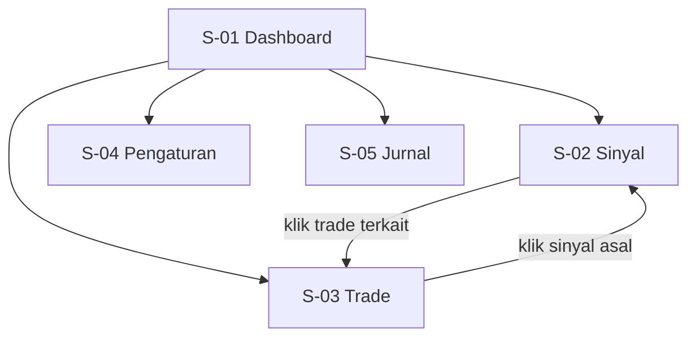
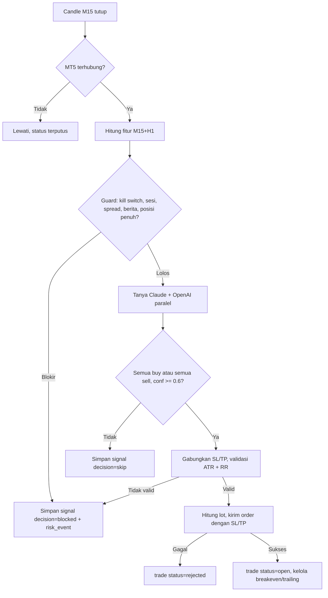

# AFD - TradingBot AI (MT5)

> Versi: 0.1 | Diperbarui: 2026-10-29 | Merujuk: PRD.md (ID fitur F-xx)

## 1. Peta Layar
| ID | Layar | Rute/URL | Akses | Fitur terkait |
|---|---|---|---|---|
| S-01 | Dashboard | `/` | Owner (localhost) | F-01, F-04, F-05, F-06 |
| S-02 | Sinyal & Opini AI | `/signals` | Owner | F-02, F-03, F-06 |
| S-03 | Posisi & Riwayat | `/trades` | Owner | F-05, F-06 |
| S-04 | Risiko & Pengaturan | `/settings` | Owner | F-04, F-06 |
| S-05 | Jurnal & Performa | `/journal` | Owner | F-07, F-06 |

## 2. Navigasi Utama
Bilah navigasi tetap di atas semua layar: Dashboard, Sinyal, Trade, Pengaturan, Jurnal. Kill switch selalu terlihat di header.

## 3. Alur Utama Bot (latar belakang)

## 4. Alur per Fitur

### F-01 Koneksi MT5 & data pasar
**Pemicu:** bot start, atau tiap siklus.
**Alur utama:**
1. Bot memanggil `initialize` ke terminal MT5 dan membaca info akun.
2. Bot membandingkan tipe akun dengan `settings.mode` (penjaga live, TRD 5).
3. Tiap siklus mengambil >= 300 candle M15 dan H1 per simbol; S-01 menampilkan status "terhubung", saldo, equity.

**Alur alternatif / gagal:**
- Terminal tidak berjalan -> status "terputus" (S-01), coba lagi tiap 10 detik, maks 5 kali, lalu bot berhenti trading dan mencatat `risk_events` (`broker_error`).
- Simbol belum terpetakan / tidak ditemukan -> bot menolak start; S-04 menampilkan kandidat dari MT5 (mis. `XAUUSDm`, `GOLD`) untuk dipilih dan disimpan ke `symbol_map`.
- Tipe akun tidak cocok dengan mode -> bot berhenti (`live_guard`).

### F-02 Analisa teknikal & filter berita
**Pemicu:** setiap candle M15 tutup; pembaruan kalender tiap 6 jam.
**Alur utama:**
1. Hitung EMA 20/50/200, RSI 14, ATR 14, MACD, swing high/low untuk M15 dan H1.
2. Cek tabel `news_events`: ada event `impact = high` mata uang terkait dalam +-30 menit?
3. Hasil fitur dimasukkan ke paket untuk AI; kalau ada berita -> sinyal `blocked` (`news_block`).

**Alur alternatif / gagal:**
- Kalender gagal diambil / lebih tua dari 24 jam -> blokir entry, `risk_events` (`news_block`, detail "kalender usang").
- Data candle kurang dari 300 -> lewati siklus simbol itu.

### F-03 Panel multi-AI & konsensus
**Pemicu:** fitur lolos guard pada candle M15 tutup.
**Alur utama:**
1. Kirim paket fitur ke Claude dan OpenAI paralel dengan prompt dan skema yang sama.
2. Validasi tiap balasan terhadap skema; simpan ke `ai_opinions`.
3. Konsensus: semua `direction` sama dan bukan `hold` dan `confidence >= 0.6` -> `signals.consensus` = buy/sell; selain itu `none`.
4. Tampil di S-02 dengan alasan tiap AI.

**Alur alternatif / gagal:**
- Timeout 30 detik / error API / JSON tidak valid -> opini ditandai error, dihitung tidak setuju, sinyal `skip`.
- Salah satu penyedia dinonaktifkan di S-04 -> konsensus hanya dari model aktif; jumlah model aktif harus >= `min_ai_models` (default 2), jika kurang bot tidak mengeksekusi.

### F-04 Manajemen risiko & kill switch
**Pemicu:** konsensus buy/sell; juga dicek tiap 10 detik untuk batas harian.
**Alur utama:**
1. Gabungkan SL (terjauh valid) dan TP (terdekat) dari semua AI.
2. Validasi jarak SL 0.8-3.0 x ATR dan reward:risk >= 1.5.
3. Hitung lot dari risiko% dan jarak SL, bulatkan ke `volume_step`.
4. Pantau rugi harian; jika mencapai batas -> kill switch ON (blokir entry), perlakukan posisi sesuai `kill_switch_mode` (default `protect_winners`: tutup yang rugi, kunci breakeven pada yang untung dan biarkan berjalan; `close_all`: tutup semua), catat `risk_events`.

**Alur alternatif / gagal:**
- SL/TP tidak valid -> `blocked` (`invalid_sltp`).
- Lot hasil hitung < `volume_min` -> `blocked` (`lot_too_small`, risiko terlalu kecil untuk saldo).
- Maks posisi / spread / sesi / kill switch aktif -> `blocked` dengan alasan masing-masing.
- Kill switch manual: owner klik tombol (S-01/S-04) -> konfirmasi -> perlakuan posisi sesuai `kill_switch_mode`, status "KILL SWITCH ON". Tombol terpisah "Tutup semua sekarang" selalu menutup semua posisi.
- Reset kill switch: tombol Reset (S-04) dengan konfirmasi; otomatis juga reset pada hari UTC berikutnya untuk pemicu batas harian.

### F-05 Eksekusi order & manajemen posisi
**Pemicu:** sinyal lolos validasi risiko; loop posisi tiap 10 detik.
**Alur utama:**
1. Kirim order market dengan SL, TP, magic number bot; simpan `trades` (`status = open`).
2. Loop posisi: pada +1R geser SL ke breakeven; setelah +1.5R trailing 1 x ATR.
3. Rekonsiliasi: posisi yang sudah tertutup di MT5 diperbarui di `trades` (harga tutup, profit, `close_reason`).

**Alur alternatif / gagal:**
- Order ditolak/requote -> 1 retry, lalu `trades.status = rejected`, `risk_events` (`broker_error`).
- Bot restart saat ada posisi -> rekonsiliasi saat start mengambil alih posisi ber-magic number bot.
- Posisi ada di MT5 tetapi tidak ada di database -> dicatat sebagai `trades` dengan `signal_id` null dan `close_reason` kelak `unknown` bila tak terlacak.

### F-06 Dashboard web lokal
**Pemicu:** owner membuka `http://127.0.0.1:8000`.
**Alur utama:**
1. Halaman memuat `/api/status` dan data layar, lalu polling tiap 5 detik.
2. Owner mengubah pengaturan di S-04 -> `PUT /api/settings` dengan token -> tersimpan -> berlaku siklus berikutnya.
3. Tombol kill switch memanggil `POST /api/kill-switch`.

**Alur alternatif / gagal:**
- Backend tidak merespons -> banner merah "Bot tidak terjangkau", data terakhir diberi tanda usang.
- Nilai pengaturan di luar batas (mis. risiko > 2%) -> ditolak dengan pesan validasi; tidak tersimpan.
- Token tidak ada/salah -> 401, pesan "Token lokal tidak valid".

### F-07 Jurnal & evaluasi performa
**Pemicu:** akhir hari UTC (otomatis), atau tombol "Buat ringkasan" di S-05.
**Alur utama:**
1. Hitung statistik dari `trades` dan `daily_stats`.
2. Kirim statistik (bukan data sensitif) ke satu model AI untuk ringkasan teks; simpan ke `journal_entries`.
3. S-05 menampilkan statistik, ringkasan, dan progres terhadap kriteria kelayakan live.

**Alur alternatif / gagal:**
- Tidak ada trade pada periode -> statistik nol, ringkasan "tidak ada trade".
- AI gagal -> statistik tetap tersimpan, `ai_summary` kosong, tombol coba lagi.

## 5. State Layar
| Layar | Kosong | Loading | Error | Sukses |
|---|---|---|---|---|
| S-01 | "Belum ada sinyal" + status bot tetap tampil | Skeleton kartu | Banner "Bot tidak terjangkau" | Kartu status, equity, posisi, sinyal terakhir |
| S-02 | "Belum ada sinyal. Menunggu candle M15 berikutnya" | Skeleton tabel | Pesan + tombol muat ulang | Tabel sinyal; baris diperluas menampilkan opini tiap AI |
| S-03 | "Belum ada trade" | Skeleton tabel | Pesan + tombol muat ulang | Tab Terbuka / Riwayat |
| S-04 | Nilai default terisi | Spinner di tombol Simpan | Pesan validasi per field | Toast "Tersimpan, berlaku siklus berikutnya" |
| S-05 | "Belum ada data jurnal" | Skeleton | Pesan + tombol coba lagi | Kartu statistik, ringkasan AI, progres kelayakan live |

## 6. Aturan Lintas Layar
- Tidak ada login; semua layar hanya via `127.0.0.1`.
- Banner mode selalu tampil di header: "DEMO" (netral) atau "LIVE" (merah, mencolok).
- Aksi destruktif (kill switch, reset, ubah mode) butuh dialog konfirmasi.
- Tidak ada notifikasi eksternal; peristiwa penting tampil sebagai baris `risk_events` di S-01.
