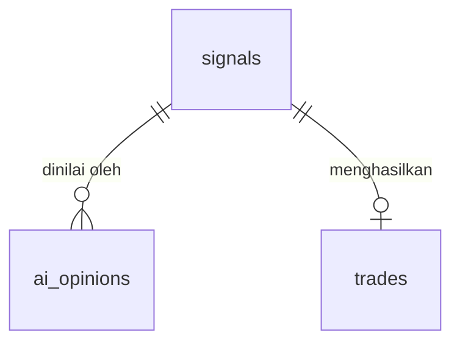

# BSD - TradingBot AI (MT5)

> Versi: 0.1 | Diperbarui: 2026-10-29 | Merujuk: PRD.md, TRD.md, AFD.md
> Database: SQLite (`data/bot.db`) | ORM/migrasi: SQLAlchemy 2.0 + Alembic

## 1. ERD

Tabel mandiri tanpa FK: `settings`, `news_events`, `risk_events`, `daily_stats`, `journal_entries` (journal merujuk `daily_stats` hanya lewat tanggal logis).

## 2. Konvensi
- Nama tabel: `snake_case` jamak; PK: `id` integer autoincrement (kecuali `settings` dan `daily_stats`).
- Kolom standar: `created_at` (UTC, default now); `updated_at` pada tabel yang dapat berubah.
- Semua waktu disimpan UTC.
- Soft delete: tidak dipakai (riwayat trading tidak dihapus).
- Harga/volume: `REAL`; profit dalam mata uang akun (`REAL`).
- Enum disimpan sebagai `TEXT` dengan `CHECK` constraint.

## 3. Tabel

### settings
Fitur: F-04, F-06 | Tujuan: pengaturan runtime dan status bot (key-value).
| Kolom | Tipe | Constraint | Keterangan |
|---|---|---|---|
| key | TEXT | PK | |
| value | TEXT | NOT NULL | Nilai sebagai string; di-parse per key |
| updated_at | DATETIME | NOT NULL | |

Key baku dan default:
| key | default | batas valid |
|---|---|---|
| mode | demo | demo, live |
| kill_switch | 0 | 0, 1 |
| kill_switch_reason | (kosong) | teks |
| symbols | XAUUSD,EURUSD | daftar dipisah koma |
| symbol_map | `{"XAUUSD":"XAUUSD","EURUSD":"EURUSD"}` | JSON; nilai harus ada di MT5 |
| breakeven_buffer_points | 0 (tambahan di luar spread + komisi) | 0 - 200 |
| kill_switch_mode | protect_winners | protect_winners, close_all |
| min_ai_models | 2 | 1 - 3 (nilai 1 hanya diizinkan saat mode demo) |
| manual_blackouts | `[]` | JSON daftar `{start_utc, end_utc, note}` |
| news_provider | faireconomy | nama provider terdaftar |
| claude_model / openai_model | dari `.env` | teks ID model |
| risk_per_trade_pct | 0.5 | 0.1 - 2.0 |
| max_daily_loss_pct | 2.0 | 0.5 - 5.0 |
| max_open_positions | 2 | 1 - 5 |
| max_positions_per_symbol | 1 | 1 - 2 |
| min_confidence | 0.6 | 0.5 - 0.95 |
| sl_atr_min / sl_atr_max | 0.8 / 3.0 | 0.5 - 5.0 |
| min_rr | 1.5 | 1.0 - 5.0 |
| max_spread_points_XAUUSD / _EURUSD | 50 / 20 | > 0 |
| session_start_utc / session_end_utc | 07:00 / 20:00 | HH:MM |
| news_block_minutes | 30 | 10 - 120 |
| ai_enabled_claude / ai_enabled_openai | 1 / 1 | 0, 1 |

### news_events
Fitur: F-02
| Kolom | Tipe | Constraint | Keterangan |
|---|---|---|---|
| id | INTEGER | PK | |
| event_time | DATETIME | NOT NULL | UTC |
| currency | TEXT | NOT NULL | mis. USD, EUR |
| title | TEXT | NOT NULL | |
| impact | TEXT | NOT NULL, CHECK in ('low','medium','high') | |
| source | TEXT | NOT NULL | nama feed |
| fetched_at | DATETIME | NOT NULL | untuk cek kalender usang |

Indeks: UNIQUE(`event_time`, `currency`, `title`) -> cegah duplikat; INDEX(`event_time`) -> cek jendela berita.

### signals
Fitur: F-02, F-03, F-04 | Tujuan: satu baris per simbol per candle M15 yang dievaluasi.
| Kolom | Tipe | Constraint | Keterangan |
|---|---|---|---|
| id | INTEGER | PK | |
| symbol | TEXT | NOT NULL | |
| timeframe | TEXT | NOT NULL, CHECK in ('M15','H1') | Entry selalu 'M15' di MVP |
| bar_time | DATETIME | NOT NULL | Waktu buka candle yang ditutup (UTC) |
| features_json | TEXT | NOT NULL | Paket fitur yang dikirim ke AI |
| consensus | TEXT | NOT NULL, CHECK in ('buy','sell','none') | |
| decision | TEXT | NOT NULL, CHECK in ('execute','skip','blocked') | |
| block_reason | TEXT | NULL | Salah satu `risk_events.type` jika `blocked` |
| entry_price | REAL | NULL | Harga acuan saat evaluasi |
| sl_price | REAL | NULL | Gabungan final |
| tp_price | REAL | NULL | Gabungan final |
| created_at | DATETIME | NOT NULL | |

Indeks: UNIQUE(`symbol`, `timeframe`, `bar_time`) -> idempotensi; INDEX(`created_at`).
Relasi: 1 signal -> N `ai_opinions` (FK `ai_opinions.signal_id`, ON DELETE CASCADE); 1 signal -> 0..1 `trades`.

### ai_opinions
Fitur: F-03
| Kolom | Tipe | Constraint | Keterangan |
|---|---|---|---|
| id | INTEGER | PK | |
| signal_id | INTEGER | FK -> signals.id, NOT NULL | |
| provider | TEXT | NOT NULL, CHECK in ('claude','openai') | |
| model | TEXT | NOT NULL | ID model yang dipakai |
| direction | TEXT | NULL, CHECK in ('buy','sell','hold') | NULL jika error |
| confidence | REAL | NULL, CHECK 0..1 | |
| sl_price | REAL | NULL | |
| tp_price | REAL | NULL | |
| rationale | TEXT | NULL | Alasan singkat dari AI |
| latency_ms | INTEGER | NULL | |
| error | TEXT | NULL | Terisi jika timeout/JSON tidak valid |
| created_at | DATETIME | NOT NULL | |

Indeks: UNIQUE(`signal_id`, `provider`).

### trades
Fitur: F-05
| Kolom | Tipe | Constraint | Keterangan |
|---|---|---|---|
| id | INTEGER | PK | |
| signal_id | INTEGER | FK -> signals.id, NULL | NULL untuk posisi yang diambil alih saat rekonsiliasi |
| mt5_ticket | INTEGER | UNIQUE, NULL | NULL jika `rejected` |
| symbol | TEXT | NOT NULL | |
| direction | TEXT | NOT NULL, CHECK in ('buy','sell') | |
| volume | REAL | NOT NULL | lot |
| entry_price | REAL | NULL | |
| sl_price | REAL | NOT NULL | Diperbarui saat breakeven/trailing |
| tp_price | REAL | NOT NULL | |
| risk_amount | REAL | NOT NULL | Uang yang dirisikokan saat entry |
| status | TEXT | NOT NULL, CHECK in ('open','closed','rejected') | |
| account_mode | TEXT | NOT NULL, CHECK in ('demo','live') | |
| opened_at | DATETIME | NULL | |
| closed_at | DATETIME | NULL | |
| close_price | REAL | NULL | |
| profit | REAL | NULL | Mata uang akun, termasuk swap/komisi |
| close_reason | TEXT | NULL, CHECK in ('tp','sl','breakeven','trailing','kill_switch','manual','unknown') | |
| created_at | DATETIME | NOT NULL | |
| updated_at | DATETIME | NOT NULL | |

Indeks: INDEX(`status`), INDEX(`symbol`, `status`), INDEX(`closed_at`).

### risk_events
Fitur: F-02, F-04, F-05
| Kolom | Tipe | Constraint | Keterangan |
|---|---|---|---|
| id | INTEGER | PK | |
| type | TEXT | NOT NULL, CHECK (lihat enum `risk_event_type`) | |
| symbol | TEXT | NULL | |
| detail | TEXT | NOT NULL | Penjelasan singkat |
| created_at | DATETIME | NOT NULL | |

Indeks: INDEX(`created_at`), INDEX(`type`).

### daily_stats
Fitur: F-04, F-07
| Kolom | Tipe | Constraint | Keterangan |
|---|---|---|---|
| date | DATE | PK | Hari UTC |
| start_balance | REAL | NOT NULL | Dasar batas rugi harian |
| end_balance | REAL | NULL | |
| trades_count | INTEGER | NOT NULL, default 0 | |
| wins | INTEGER | NOT NULL, default 0 | |
| losses | INTEGER | NOT NULL, default 0 | |
| net_profit | REAL | NOT NULL, default 0 | |
| max_drawdown_pct | REAL | NOT NULL, default 0 | |
| updated_at | DATETIME | NOT NULL | |

### journal_entries
Fitur: F-07
| Kolom | Tipe | Constraint | Keterangan |
|---|---|---|---|
| id | INTEGER | PK | |
| period | TEXT | NOT NULL, CHECK in ('daily','weekly') | |
| period_start | DATE | NOT NULL | |
| stats_json | TEXT | NOT NULL | win rate, profit factor, dll. |
| ai_summary | TEXT | NULL | |
| created_at | DATETIME | NOT NULL | |

Indeks: UNIQUE(`period`, `period_start`).

## 4. Enum & Nilai Referensi
| Enum | Nilai | Arti |
|---|---|---|
| direction (signals.consensus, trades) | buy, sell, none (hanya consensus) | Arah |
| ai direction | buy, sell, hold | Saran AI |
| signals.decision | execute, skip, blocked | Dieksekusi / tidak ada konsensus / diblokir aturan |
| trades.status | open -> closed; rejected (final) | Transisi: open->closed saja |
| risk_event_type | daily_loss_limit, kill_switch_on, kill_switch_off, max_positions, spread_too_wide, news_block, outside_session, invalid_sltp, lot_too_small, broker_error, ai_error, live_guard | Jenis peristiwa risiko |

## 5. Aturan Akses (otorisasi data)
Satu peran (owner), hanya dari `127.0.0.1`.
| Tabel | Baca | Tulis via API | Tulis oleh bot |
|---|---|---|---|
| settings | ya | ya (PUT /api/settings, dengan token) | `kill_switch*` |
| news_events | ya | tidak | ya |
| signals, ai_opinions | ya | tidak | ya |
| trades | ya | tidak (penutupan lewat kill switch) | ya |
| risk_events, daily_stats | ya | tidak | ya |
| journal_entries | ya | ya (POST /api/journal/generate) | ya |

`mode` tidak bisa diubah ke `live` lewat API; hanya lewat penjaga di TRD bagian 5 (perubahan manual `.env` + settings).

## 6. Kontrak API Ringkas
Semua endpoint `GET` tanpa token; `PUT/POST` wajib header `X-Local-Token`.
| Method | Path | Request | Response sukses | Error |
|---|---|---|---|---|
| GET | /api/status | - | 200 `{ mode, kill_switch, mt5_connected, balance, equity, daily_pnl_pct, open_positions, last_cycle_at }` | 500 |
| GET | /api/signals | `?symbol&limit` | 200 `{ items: [signal + opinions[]] }` | 400 |
| GET | /api/signals/{id} | - | 200 `signal + opinions[]` | 404 |
| GET | /api/trades | `?status&limit` | 200 `{ items: [trade] }` | 400 |
| GET | /api/risk-events | `?limit` | 200 `{ items: [risk_event] }` | 400 |
| GET | /api/settings | - | 200 `{ key: value, ... }` | 500 |
| PUT | /api/settings | `{ key: value, ... }` (subset) | 200 `{ updated: [keys] }` | 400 (di luar batas), 401, 403 (coba set `mode=live`) |
| POST | /api/kill-switch | `{ on: bool, panic?: bool }` | 200 `{ kill_switch, closed_positions, protected_positions }` | 401 |
| GET | /api/symbols/candidates | `?canonical=XAUUSD` | 200 `{ items: [broker_symbol] }` | 503 (MT5 terputus) |
| GET | /api/journal | `?period=daily\|weekly` | 200 `{ items: [journal_entry], live_readiness }` | 400 |
| POST | /api/journal/generate | `{ period, period_start }` | 201 `journal_entry` | 401, 502 (AI gagal) |

Format error standar: `{ "error": { "code": "...", "message": "..." } }`

## 7. Migrasi & Seed
- Urutan migrasi: `settings` -> `news_events` -> `signals` -> `ai_opinions` -> `trades` -> `risk_events` -> `daily_stats` -> `journal_entries`.
- Seed: baris `settings` dengan nilai default di atas (dibuat saat start jika belum ada). Data contoh dev: sinyal/trade palsu hanya untuk tes, tidak untuk produksi.

## 8. Kebijakan Data
- Retensi: semua data disimpan tanpa batas (ukuran kecil); `features_json` boleh dibersihkan > 90 hari.
- Data sensitif: API key tidak pernah masuk database; `rationale` dan `features_json` hanya berisi data pasar.
- Cadangan: salin `data/bot.db` secara manual sebelum migrasi.
