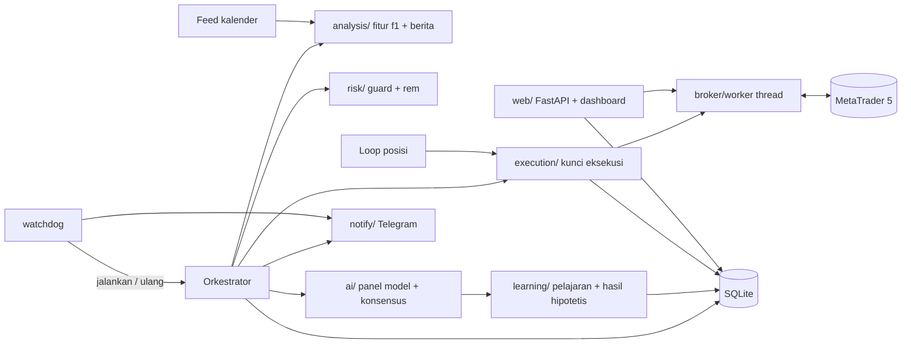

# TRD - TradingBot AI (MT5)

> Versi: 0.5 | Diperbarui: 2026-10-29 | Merujuk: PRD.md

## 1. Tech Stack
| Lapisan | Pilihan | Alasan (1 kalimat) |
|---|---|---|
| Bahasa/runtime | Python 3.11 (64-bit) | Paket `MetaTrader5` resmi hanya untuk Python di Windows. |
| Backend & loop bot | FastAPI + asyncio (satu proses bot) | Satu proses menjalankan loop trading, job, dan API dashboard, tanpa orkestrasi tambahan. |
| Server ASGI | `uvicorn` | Menjalankan aplikasi FastAPI (dashboard + API) di dalam proses bot. |
| Pengawas | Proses `watchdog` terpisah (Python) | Menjalankan ulang bot saat crash/macet dan mengirim notifikasi (F-09). |
| Frontend | Jinja2 + HTML/CSS + JS polos (polling 5 detik) | Dashboard lokal sederhana, tanpa build step. |
| Database | SQLite mode WAL (file `data/bot.db`) + SQLAlchemy 2.0 + Alembic | Satu pengguna, tanpa server DB, migrasi terversi, baca-tulis bersamaan aman. |
| Broker | MetaTrader 5 via paket `MetaTrader5` (hanya Windows) | Sesuai kebutuhan; diabstraksi lewat antarmuka `Broker`. |
| AI | SDK `anthropic` dan `openai` | Dua penyedia independen untuk konsensus. |
| Indikator | `pandas` + `numpy` (perhitungan sendiri, teruji) | EMA/RSI/ATR/MACD sederhana; kendali penuh atas smoothing agar sama dengan MT5. |
| HTTP klien | `httpx` | Kalender ekonomi dan Telegram, timeout jelas. |
| Notifikasi | Telegram Bot API (satu arah) lewat `httpx` | Gratis, sampai ke HP owner, tanpa server tambahan. |
| Auth | Tidak ada login; bind `127.0.0.1` + header `X-Local-Token` untuk aksi tulis | Pengguna tunggal, lokal. |
| Hosting | PC Windows pemilik atau VPS Windows; `start.bat` menjalankan watchdog | Terminal MT5 harus jalan di mesin yang sama. |

Versi runtime & package manager: Python 3.11, `pip` + `venv`, dependensi di `pyproject.toml` dengan versi dipin (`==`); upgrade dilakukan sengaja. `MetaTrader5` dipasang dengan penanda `sys_platform == "win32"`, sehingga `pip install -e .[dev]` juga berhasil di Linux/CI (memakai `MockBroker`).

## 2. Arsitektur
Dua proses. **Watchdog** (`python -m tradingbot.watchdog`, dijalankan `start.bat`) menjalankan proses bot, memantau heartbeat, dan menjalankan ulang bila crash/macet (F-09). **Proses bot** (satu instans, dikunci `data/bot.lock`) berisi orkestrator, loop posisi, job, notifikasi, dan API dashboard. Semua panggilan MT5 lewat satu thread pekerja (`broker/worker.py`).

Siklus per candle M15 tutup: ambil data (F-01) -> fitur `f1` + berita (F-02) -> guard dan rem (F-04) -> semua model AI paralel + efek pelajaran + konsensus (F-03, F-08) -> kunci eksekusi: cek ulang guard, validasi harga dan margin, kirim order (F-04, F-05) -> simpan ke SQLite. Loop posisi tiap 10 detik: breakeven/trailing, rekonsiliasi, batas harian/mingguan, heartbeat. Tiap candle tutup: hasil hipotetis (F-08). Sabtu 00:00 UTC: job pelajaran mingguan (F-08). Kejadian kritis dikirim ke Telegram (F-09). Dashboard (F-06, F-07) membaca SQLite dan memanggil modul lewat API FastAPI.



Keputusan penting:
| Keputusan | Alternatif ditolak | Alasan |
|---|---|---|
| Antarmuka `Broker` + `MockBroker` | Panggil `MetaTrader5` langsung | MT5 hanya jalan di Windows; mock membuat tes jalan di mana pun. |
| Satu thread pekerja untuk semua panggilan MT5 | Panggil dari mana saja | Paket `MetaTrader5` tidak dirancang untuk diakses paralel. |
| AI hanya memberi arah + SL/TP; lot, batas, eksekusi dihitung kode | Biarkan AI menentukan lot | Risiko tidak boleh bergantung pada keluaran model. |
| Semua model wajib setuju | Mayoritas | Permintaan owner; lebih konservatif. |
| Strategi diskresi penuh AI | Setup berbasis aturan + AI sebagai penyaring | Keputusan owner; dikompensasi rem tambahan F-04. |
| Pelajaran terstruktur (kondisi + efek), efek diterapkan kode | Pelajaran teks bebas di prompt saja | Bisa diverifikasi kode dan dijamin hanya memperketat. |
| Teks pelajaran dari template kode | Teks bebas dari AI | Teks AI bisa menyelipkan instruksi yang melonggarkan. |
| Hasil hipotetis dari candle berikutnya | Backtesting penuh | Cukup untuk verifikasi pelajaran dan scorecard tanpa engine backtest. |
| Penentang mingguan silang penyedia | Penentang per trade | Tanpa tambahan latensi/biaya per keputusan. |
| Batas spread/slippage relatif ATR | Batas dalam points | Points bergantung jumlah digit harga di tiap broker. |
| Telegram satu arah + watchdog | Perintah lewat Telegram | Lebih aman; kontrol tetap dari dashboard lokal. |
| Panggil AI saat candle M15 tutup | Tiap tick/menit | Biaya API terkendali, cocok timeframe. |
| Satu proses bot | Worker terpisah (Celery dsb.) | Terlalu berat untuk pengguna tunggal. |
| SQLite | PostgreSQL | Tanpa server; data kecil. |

## 3. Struktur Folder
```
src/tradingbot/
  main.py              # entry proses bot: orkestrator, loop posisi, job, web
  watchdog.py          # proses pengawas: jalankan/ulang bot, cek heartbeat, notifikasi
  clock.py             # antarmuka Clock (bisa dipalsukan saat tes)
  config.py            # baca .env + tabel settings, validasi, catat settings_changes
  db/                  # models.py, session.py, repo
  broker/              # base.py (Broker), worker.py (thread MT5), mt5.py, mock.py
  analysis/            # indicators.py, features.py (skema f1), news.py
  ai/                  # base.py (AIProvider + registry), claude.py, openai_provider.py, prompts.py, schema.py, consensus.py, calls.py (ai_calls, biaya, kesehatan)
  learning/            # paper.py (hasil hipotetis), reflection.py, lessons.py (usulan, verifikasi, efek, template), reviewer.py (penentang), versions.py (prompt_versions, rollback), weekly.py (job mingguan)
  risk/                # sizing.py, validator.py, guard.py (guard + rem), killswitch.py
  execution/           # executor.py (kunci eksekusi, idempotensi), position_manager.py, reconcile.py
  journal/             # stats.py, scorecard.py, summary.py
  notify/              # telegram.py, events.py (jenis kejadian, cooldown)
  web/                 # app.py, api.py, templates/, static/
migrations/            # Alembic
scripts/               # check_mt5.py
tests/
docs/
data/                  # bot.db, bot.lock, heartbeat (di-gitignore)
logs/                  # di-gitignore
.env.example
start.bat
pyproject.toml
```

## 4. Konvensi Kode
- Bahasa & mode ketat: Python 3.11, type hints wajib di fungsi publik, `mypy` tidak diwajibkan; `from __future__ import annotations`.
- Penamaan: file/fungsi `snake_case`, kelas `PascalCase`, tabel `snake_case` jamak, enum nilai huruf kecil.
- Validasi input: Pydantic v2 untuk request API, keluaran AI (`ai/schema.py`), usulan pelajaran, dan config.
- Penanganan error: exception khusus (`BrokerError`, `AIError`, `RiskBlocked`); error API format `{ "error": { "code", "message" } }`; kejadian risiko dicatat ke `risk_events`, blokir rutin ke `signals.block_reason`, tidak ada error yang ditelan.
- Waktu: simpan UTC (`datetime` timezone-aware); semua logika memakai `Clock` (tidak memanggil `datetime.now()` langsung) agar bisa diuji dengan jam palsu; UI menampilkan jam lokal browser dengan UTC di tooltip.
- Uang/harga: harga `float` dari broker apa adanya; hitung lot dengan `Decimal` atau pembulatan eksplisit ke `volume_step`.
- Lint/format: `ruff check .` dan `ruff format .`.
- Dilarang: API key/token di kode/log, SQL mentah tanpa parameter, memanggil `MetaTrader5` di luar `broker/mt5.py` atau di luar thread pekerja, mengirim order tanpa SL/TP atau di luar kunci eksekusi, memasukkan teks bebas keluaran AI ke prompt mana pun, menghapus penjaga risiko demi tes, mengubah `mode` ke live dari kode.

## 5. Keamanan
- Autentikasi: tidak ada login; server bind `127.0.0.1` pada `DASHBOARD_PORT` (default 8000). Semua request dengan header `Host` selain `127.0.0.1:<port>`/`localhost:<port>` ditolak 400 (anti DNS rebinding). Endpoint tulis (PUT/POST) wajib header `X-Local-Token` = `DASHBOARD_TOKEN` dari `.env`; server menyisipkan token ke halaman dashboard yang disajikannya (meta tag), JS membacanya dari sana. Tanpa CORS.
- Otorisasi: satu peran (owner); lihat BSD bagian 5.
- Penjaga mode live (semua harus benar, jika tidak bot menolak start):
  1. `LIVE_ENABLED=true` di `.env`
  2. `settings.mode = 'live'`
  3. Tipe akun MT5 = real (`account_info.trade_mode`) konsisten dengan mode
  4. Default dan fallback selalu `demo`; ketidakcocokan -> bot berhenti dan mencatat `risk_events.type = 'live_guard'`.
- Data sensitif: API key, token dashboard, dan token Telegram hanya di `.env` (di-gitignore); log dan pesan Telegram disaring dari secret; pesan Telegram hanya memuat angka dalam %, tanpa saldo nominal.
- Koneksi keluar: hanya API Anthropic, API OpenAI, `api.telegram.org`, dan feed kalender.
- Sumber konfigurasi: tabel `settings` adalah sumber kebenaran runtime; nilai `.env` (`ANTHROPIC_MODEL` dan `OPENAI_MODEL` -> isi awal `ai_models`; `NEWS_PROVIDER`) hanya dipakai sebagai nilai awal saat seed. Secret (API key, token, `LIVE_ENABLED`) hanya di `.env`, tidak pernah di `settings`. Setiap perubahan `settings` dicatat di `settings_changes`.
- Secrets & variabel: lewat environment variable, daftar di `.env.example`: `ANTHROPIC_API_KEY`, `OPENAI_API_KEY`, `ANTHROPIC_MODEL` (contoh `claude-sonnet-5-5`), `OPENAI_MODEL` (wajib diisi owner), `NEWS_PROVIDER`, `MT5_PATH` (opsional), `DASHBOARD_TOKEN`, `DASHBOARD_PORT`, `TELEGRAM_BOT_TOKEN`, `TELEGRAM_CHAT_ID`, `LIVE_ENABLED`, `DB_PATH`.

## 5a. Aturan Broker MT5
- Semua panggilan `MetaTrader5` dijalankan berurutan di satu thread pekerja (`broker/worker.py`), termasuk yang dipicu request dashboard; event loop menunggu hasilnya secara async.
- Akun wajib bertipe hedging (`account_info.margin_mode`); netting -> tolak start.
- Algo Trading terminal wajib aktif (`terminal_info.trade_allowed`); jika tidak -> tolak start dengan pesan.
- Data: ambil >= 2000 candle M15 dan >= 1000 candle H1; hanya candle yang sudah tutup dipakai untuk fitur.
- `type_filling` order dipilih dari `symbol_info.filling_mode` (FOK/IOC/RETURN), bukan dikodekan tetap.
- Setiap SL/TP baru (order maupun modifikasi) divalidasi terhadap `trade_stops_level` dan `trade_freeze_level`.
- Lot dihitung dengan `trade_tick_size`, `trade_tick_value_loss`, dan 2 x `commission_per_lot` (pulang-pergi), dibulatkan ke bawah ke `volume_step`.
- Buffer breakeven (jarak harga) = 2 x `commission_per_lot` x `trade_tick_size` / `trade_tick_value` + `breakeven_buffer_points` x `point`. Spread tidak dihitung (BUY: entry di ask, SL terpicu di bid; SELL sebaliknya).
- Spread dibandingkan dengan `max_spread_atr_ratio` x ATR M15 (bukan points tetap).
- Sebelum `order_send`: `order_check` untuk margin; margin level setelah order harus >= `min_margin_level_pct`.
- Order: magic bot, comment `tb:<signal_id>`, `deviation` = `max_slippage_atr_ratio` x ATR M15 / `point`.
- Idempotensi: sebelum retry, atau jika hasil `order_send` tidak pasti, cari posisi/deal dengan magic + simbol + waktu sejak sinyal (+ comment bila broker mempertahankannya; beberapa broker mengubah comment); jika ada -> ambil alih, jangan kirim ulang.
- Kunci eksekusi: hanya satu order diproses pada satu waktu; semua guard, rem, dan validasi diulang di dalam kunci.
- Trailing: modifikasi SL hanya jika perbaikan >= `trailing_min_step_atr` x ATR.
- Baseline rugi harian/mingguan dari riwayat deal (`history_deals_get`): balance sekarang - profit bersih trading sejak 00:00 UTC (atau Senin 00:00 UTC); deal deposit/penarikan tidak dihitung sebagai profit. Penghitung kalah beruntun dan entry harian dari tabel `trades`.
- Hanya posisi dengan magic number bot yang dikelola/diambil alih; posisi lain diabaikan (akun khusus bot) tetapi ikut di equity.
- Sebelum entry, cek pasar simbol terbuka (`symbol_info.trade_mode` + sesi simbol); tutup -> `market_closed`.
- Reconnect: 10 detik x 5 kali, lalu tiap 60 detik tanpa batas; lanjut otomatis.
- Satu instans: file kunci `data/bot.lock` (dilepas saat proses berhenti); gagal mengunci -> tolak start.
- Heartbeat: loop posisi menulis waktu ke `data/heartbeat` tiap 10 detik; dipantau watchdog dan ditampilkan di `/api/status`.

## 5b. Aturan AI
- Temperature tetap rendah (0-0.2) per penyedia; `prompt_version` (mis. `v1`) didefinisikan di `ai/prompts.py`; `prompt_version` dan `feature_schema` disimpan di tiap `signals`.
- Penyedia didaftarkan di registry; `ai_opinions.provider` + `model` bebas (tanpa CHECK), sehingga penyedia atau model tambahan tidak butuh migrasi.
- Daftar model di `settings.ai_models` (JSON `[{provider, model, enabled}]`); konsensus memakai semua entri `enabled`; total <= `max_ai_models`; panggilan paralel sehingga latensi = model paling lambat (timeout 30 detik).
- Prompt menyertakan paket fitur `f1` (5c), batas `sl_atr_min`/`sl_atr_max`, `min_rr`, aturan sisi SL/TP, dan teks pelajaran milik model itu; skema menolak SL/TP di sisi salah.
- Teks bebas keluaran AI (rationale, refleksi, catatan penentang) hanya disimpan dan ditampilkan; tidak pernah dimasukkan ke prompt mana pun.
- Pencatatan: setiap panggilan dicatat di `ai_calls` (tujuan, model, token, perkiraan biaya dari `ai_price_table`, latensi, ok/error). Sebelum memanggil AI untuk keputusan, cek `max_ai_calls_per_day`; tercapai -> `ai_budget`.
- Kesehatan: per model, hitung error beruntun dari `ai_calls`; >= `ai_error_alert_count`, atau error autentikasi/model tidak ditemukan -> tidak sehat (`ai_unhealthy`, risk_event + notifikasi). Selama ada model aktif yang tidak sehat, sinyal diblokir tanpa memanggil model lain; model itu diuji ulang (tujuan `probe`) tiap 4 candle dan pulih setelah satu panggilan sukses.
- Ringkasan jurnal (F-07) dan penentang memakai model aktif pertama yang relevan di `ai_models`; jurnal hanya menerima statistik.
- Pelajaran (F-08) terstruktur: `condition_json` atas kunci fitur skalar skema `f1` (operator `>`, `<`, `>=`, `<=`, `==`, digabung AND), `symbol`/`direction` opsional, efek `avoid` atau `raise_confidence`. Kode mengevaluasi kondisi dan menerapkan efek pada opini model pemilik sebelum konsensus. Teks pelajaran dibuat kode dari template, mis. "Hindari BUY XAUUSD saat rsi14_m15 > 70 (bukti: 24 sampel, rata-rata -0.4R)".
- `lesson_key` = hash dari penyedia, model, simbol, arah, kondisi ternormalisasi (kunci diurutkan), dan efek; dipakai untuk penggabungan duplikat dan cooldown.
- Refleksi: satu panggilan per model per trade tertutup yang punya sinyal asal; balasan terstruktur berisi refleksi + usulan pelajaran opsional.
- Hasil hipotetis (`learning/paper.py`): dibuat untuk setiap opini buy/sell (arah asli, SL/TP asli) dan setiap sinyal yang dibatalkan pelajaran (`raw_consensus` buy/sell, `consensus` none). Entry = ask (buy) atau bid (sell) saat evaluasi. Diselesaikan tiap candle M15 tutup memakai candle setelah `bar_time` sinyal (candle MT5 berbasis bid; untuk sell, high/low ditambah spread saat sinyal). SL dan TP di candle sama -> SL. Setelah `paper_horizon_candles` -> `timeout` dengan R dari close candle terakhir.
- Penentang: model aktif pertama dari penyedia lain (jika tidak ada, pelajaran pending tidak diaktifkan); satu panggilan per model pemilik per minggu; menerima data terstruktur + teks template + bukti; keluaran terstruktur (`lesson_id`, `verdict` keep/reject, alasan).
- Job mingguan (`learning/weekly.py`) pada `lesson_review_utc`, idempotensi per minggu (`prompt_versions.week_start`), urutan:
  1. Selesaikan hasil hipotetis yang tertunda.
  2. Verifikasi ulang pelajaran aktif dengan bukti terbaru; tidak lolos atau lewat `lesson_expiry_weeks` -> `expired`.
  3. Rollback: versi aktif punya >= `rollback_min_trades` trade nyata (tanpa kill_switch/manual/unknown) dan rata-rata R lebih buruk dari versi sebelumnya -> aktifkan kembali baris versi sebelumnya (tanpa baris baru), pelajaran baru di versi buruk -> `rolled_back`; lewati langkah 4-5 minggu ini.
  4. Penentang menilai pending dan aktif: `reject` -> `rejected` / `disabled`.
  5. Aktivasi pending (batas `lesson_max_active` per model dan `lesson_max_active_total`; bukti terlemah tidak diaktifkan); jika set berubah, buat versi baru berlaku Senin.
  - `lessons_frozen` = 1 -> langkah 2-5 hanya mencatat penilaian; anggaran AI tercapai -> langkah 4 ditunda.

## 5c. Skema Fitur `f1`
Paket untuk AI dan sumber kunci kondisi pelajaran. Disimpan sebagai `signals.features_json` dengan `signals.feature_schema = 'f1'`.
- Sumber: hanya candle yang sudah tutup; harga dibulatkan ke `digits` simbol; RSI dan ATR memakai smoothing Wilder (seperti MT5).
- Konteks untuk AI (tidak dipakai di kondisi pelajaran): 50 candle M15 dan 30 candle H1 terakhir (OHLC), harga bid/ask saat ini, ATR14 dalam harga, level 3 swing high dan 3 swing low terakhir per timeframe (harga).
- Fitur skalar per timeframe (sufiks `_m15` / `_h1`):
  - `ema20_dist_atr`, `ema50_dist_atr`, `ema200_dist_atr`: (close - EMA) / ATR14
  - `ema20_slope_atr`: (EMA20 sekarang - EMA20 5 candle lalu) / ATR14
  - `rsi14`
  - `macd_hist_atr`: histogram MACD(12,26,9) / ATR14
  - `swing_high_dist_atr`, `swing_low_dist_atr`: jarak close ke swing high/low terakhir / ATR14 (swing = fractal 5-bar: 2 candle kiri dan 2 kanan)
- Fitur skalar umum: `atr_pct_rank_20d` (persentil ATR14 M15 terhadap 20 hari bursa), `spread_atr_ratio`, `hour_utc`, `weekday` (0 = Senin), `minutes_to_next_high_news` (NULL jika > 240).
- Tidak berisi: P/L akun, riwayat trade, posisi lain, teks berita (agar AI tidak terpengaruh kalah/menang dan aman dari teks pihak ketiga).
- Kunci yang boleh dipakai `condition_json`: semua fitur skalar di atas, persis dengan namanya (mis. `rsi14_m15`, `ema200_dist_atr_h1`).
- Mengubah skema -> versi baru (mis. `f2`); pelajaran dengan skema lama otomatis `expired`.

## 6. Environment & Deploy
| Env | Tujuan | Catatan |
|---|---|---|
| dev/CI (Linux/Windows) | Tes unit dengan `MockBroker`, AI palsu, jam palsu | Tanpa MT5, tanpa API key, tanpa Telegram. |
| windows-demo | Jalan nyata di akun demo khusus bot | PC pribadi atau VPS Windows (disarankan untuk uptime 24/5); MT5 login ke akun demo; `start.bat` menjalankan watchdog; Task Scheduler menjalankan MT5 dan `start.bat` saat login. |
| windows-live | Ditunda | Hanya setelah kriteria PRD bagian 3 terpenuhi dan disetujui owner. |

Checklist uptime (dimuat di README): matikan sleep/hibernate, atur jam aktif Windows Update, auto-login + Task Scheduler, Algo Trading MT5 aktif, koneksi internet stabil.
Variabel lingkungan: lihat `.env.example`.
CI/CD: tidak ada untuk MVP; `ruff` dan `pytest` dijalankan lokal.

## 7. Strategi Testing
- Unit: `pytest` untuk fitur `f1` (nilai acuan, tanpa lookahead), sizing lot, validator SL/TP, guard dan rem (termasuk setelah restart), konsensus, kesehatan dan anggaran AI, kill switch, parser keluaran AI (termasuk JSON rusak), hasil hipotetis, usulan/verifikasi/efek pelajaran, template teks, duplikat dan cooldown, job mingguan dan rollback, idempotensi order, kunci eksekusi, notifikasi dan cooldown-nya.
- Semua logika waktu diuji dengan `Clock` palsu.
- `MockBroker` mensimulasikan spread, `stops_level`, `freeze_level`, slippage, partial fill, `order_check` margin, deal deposit/penarikan, hasil `order_send` yang hilang, dan putus koneksi.
- Integrasi: alur lengkap dengan `MockBroker` + AI palsu (siklus candle -> sinyal -> order -> sinkron -> hasil hipotetis).
- Manual di Windows (langkah IPD bertanda [Windows]): checklist terhadap akun demo.
- Perintah standar: `pytest`, `ruff check .`, `python -m tradingbot` (jalankan bot), `python -m tradingbot.watchdog` (jalankan lewat pengawas), tidak ada build.

## 8. Non-Fungsional Teknis
- Performa: panggilan AI paralel (`asyncio.gather`), timeout 30 detik per model; total siklus <= 60 detik.
- Skala awal: 2 simbol x 2 timeframe; ~1-3 MB data/hari di SQLite (fitur + candle ringkas). SQLite mode WAL.
- Observability: log berputar ke `logs/bot.log` (level INFO); `risk_events` hanya untuk kejadian risiko; `ai_calls` untuk token dan biaya; `/api/status` memuat heartbeat, blokir aktif, kesehatan AI, panggilan dan biaya AI hari ini, status notifikasi.
- Idempotensi: `signals` unik per (`symbol`, `timeframe`, `bar_time`); order idempoten (5a); job mingguan sekali per minggu; satu hasil hipotetis per opini.

## 9. Risiko Teknis
- `MetaTrader5` hanya Windows -> abstraksi `Broker` + mock + penanda platform; langkah MT5 diuji manual.
- Paket MT5 dipanggil paralel -> hasil tidak terduga -> satu thread pekerja.
- Respons order hilang -> order ganda -> idempotensi, kunci eksekusi, kunci satu instans.
- Feed kalender gratis (tidak resmi) berubah/mati -> fail-safe blokir entry + log; `NewsProvider` dapat diganti di `analysis/news.py`; jendela blokir manual sebagai cadangan.
- Perbedaan nama simbol dan jumlah digit antarbroker -> `symbol_map` + auto-deteksi kandidat dari `symbols_get`; batas spread/slippage relatif ATR.
- Biaya/latensi API AI -> panggilan hanya saat candle tutup setelah guard, timeout, `ai_calls`, batas harian.
- Model AI dipensiunkan atau kredit habis -> kesehatan AI + banner + notifikasi.
- Keluaran AI tidak valid -> skema Pydantic ketat; gagal = tidak setuju.
- Jam/zona waktu server broker berbeda dari UTC -> semua waktu dinormalisasi ke UTC di `broker/mt5.py`.
- PC sleep/restart -> watchdog, Task Scheduler, checklist, opsi VPS.
- Telegram gagal -> retry, status di dashboard, trading tidak bergantung padanya.
