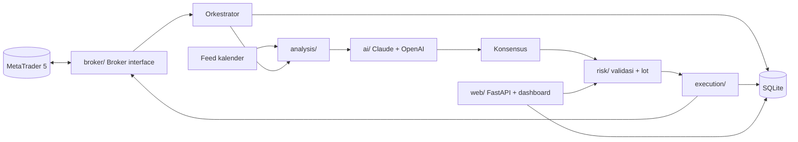

# TRD - TradingBot AI (MT5)

> Versi: 0.1 | Diperbarui: 2026-10-29 | Merujuk: PRD.md

## 1. Tech Stack
| Lapisan | Pilihan | Alasan (1 kalimat) |
|---|---|---|
| Bahasa/runtime | Python 3.11 (64-bit) | Paket `MetaTrader5` resmi hanya untuk Python di Windows. |
| Backend & loop bot | FastAPI + asyncio (satu proses) | Satu proses menjalankan loop trading dan API dashboard, tanpa orkestrasi tambahan. |
| Frontend | Jinja2 + HTML/CSS + JS polos (polling 5 detik) | Dashboard lokal sederhana, tanpa build step. |
| Database | SQLite (file `data/bot.db`) + SQLAlchemy 2.0 + Alembic | Satu pengguna, tanpa server DB, migrasi terversi. |
| Broker | MetaTrader 5 via paket `MetaTrader5` | Sesuai kebutuhan; diabstraksi lewat antarmuka `Broker`. |
| AI | SDK `anthropic` dan `openai` | Dua penyedia independen untuk konsensus. |
| Indikator | `pandas` + `ta` (atau perhitungan manual numpy) | Cukup untuk EMA/RSI/ATR/MACD. |
| HTTP klien | `httpx` | Ambil kalender ekonomi, timeout jelas. |
| Auth | Tidak ada login; bind `127.0.0.1` + header `X-Local-Token` untuk aksi tulis | Pengguna tunggal, lokal. |
| Hosting | PC Windows pemilik, jalan via `start.bat` | Terminal MT5 harus jalan di mesin yang sama. |

Versi runtime & package manager: Python 3.11, `pip` + `venv`, dependensi di `pyproject.toml`.

## 2. Arsitektur
Satu proses Python. **Orkestrator** menunggu candle M15 ditutup, lalu: ambil data (F-01) -> hitung fitur + cek berita (F-02) -> tanya semua AI paralel dan hitung konsensus (F-03) -> validasi risiko (F-04) -> eksekusi (F-05) -> simpan semua ke SQLite. Loop terpisah mengelola posisi (breakeven/trailing) dan rekonsiliasi tiap 10 detik. Dashboard (F-06, F-07) membaca SQLite dan memanggil modul lewat API FastAPI.



Keputusan penting:
| Keputusan | Alternatif ditolak | Alasan |
|---|---|---|
| Antarmuka `Broker` + `MockBroker` | Panggil `MetaTrader5` langsung | MT5 hanya jalan di Windows; mock membuat tes jalan di mana pun. |
| AI hanya memberi arah + SL/TP; lot, batas, eksekusi dihitung kode | Biarkan AI menentukan lot | Risiko tidak boleh bergantung pada keluaran model. |
| Semua model wajib setuju | Mayoritas | Permintaan owner; lebih konservatif. |
| Panggil AI saat candle M15 tutup | Tiap tick/menit | Biaya API terkendali, cocok timeframe. |
| Satu proses | Worker terpisah (Celery dsb.) | Terlalu berat untuk pengguna tunggal. |
| SQLite | PostgreSQL | Tanpa server; data kecil. |

## 3. Struktur Folder
```
src/tradingbot/
  main.py              # entry: jalankan loop bot + web
  config.py            # baca .env + tabel settings
  db/                  # models.py, session.py, repo
  broker/              # base.py (Broker), mt5.py, mock.py
  analysis/            # indicators.py, features.py, news.py
  ai/                  # base.py (AIProvider + registry), claude.py, openai_provider.py, prompts.py, schema.py, consensus.py
  risk/                # sizing.py, validator.py, guard.py (kill switch, limit)
  execution/           # executor.py, position_manager.py, reconcile.py
  journal/             # stats.py, summary.py
  web/                 # app.py, api.py, templates/, static/
migrations/            # Alembic
tests/
docs/
data/                  # bot.db (di-gitignore)
.env.example
start.bat
pyproject.toml
```

## 4. Konvensi Kode
- Bahasa & mode ketat: Python 3.11, type hints wajib di fungsi publik, `mypy` tidak diwajibkan; `from __future__ import annotations`.
- Penamaan: file/fungsi `snake_case`, kelas `PascalCase`, tabel `snake_case` jamak, enum nilai huruf kecil.
- Validasi input: Pydantic v2 untuk request API, keluaran AI (`ai/schema.py`), dan config.
- Penanganan error: exception khusus (`BrokerError`, `AIError`, `RiskBlocked`); error API format `{ "error": { "code", "message" } }`; error keputusan dicatat ke `risk_events`, bukan ditelan.
- Waktu: simpan UTC (`datetime` timezone-aware); konversi hanya di UI.
- Uang/harga: harga `float` dari broker apa adanya; hitung lot dengan `Decimal` atau pembulatan eksplisit ke `volume_step`.
- Lint/format: `ruff check .` dan `ruff format .`.
- Dilarang: API key di kode/log, SQL mentah tanpa parameter, memanggil `MetaTrader5` di luar `broker/mt5.py`, mengirim order tanpa SL/TP, menghapus penjaga risiko demi tes, mengubah `mode` ke live dari kode.

## 5. Keamanan
- Autentikasi: tidak ada login; server bind `127.0.0.1` saja. Endpoint tulis (PUT/POST) wajib header `X-Local-Token` = `DASHBOARD_TOKEN` dari `.env` (mencegah halaman web lain menembak localhost).
- Otorisasi: satu peran (owner); lihat BSD bagian 5.
- Penjaga mode live (semua harus benar, jika tidak bot menolak start):
  1. `LIVE_ENABLED=true` di `.env`
  2. `settings.mode = 'live'`
  3. Tipe akun MT5 = real (`account_info.trade_mode`) konsisten dengan mode
  4. Default dan fallback selalu `demo`; ketidakcocokan -> bot berhenti dan mencatat `risk_events.type = 'live_guard'`.
- Data sensitif: API key & token hanya di `.env` (di-gitignore); log disaring dari key.
- Secrets: lewat environment variable, daftar di `.env.example`: `ANTHROPIC_API_KEY`, `OPENAI_API_KEY`, `ANTHROPIC_MODEL` (contoh `claude-sonnet-5-5`), `OPENAI_MODEL` (wajib diisi owner), `NEWS_PROVIDER`, `MT5_PATH` (opsional), `DASHBOARD_TOKEN`, `LIVE_ENABLED`, `DB_PATH`.

## 6. Environment & Deploy
| Env | Tujuan | Catatan |
|---|---|---|
| dev/CI (Linux/Windows) | Tes unit dengan `MockBroker` dan AI palsu | Tanpa MT5, tanpa API key. |
| windows-demo | Jalan nyata di akun demo | MT5 terbuka dan login ke akun demo; `start.bat`. |
| windows-live | Ditunda | Hanya setelah kriteria PRD bagian 3 terpenuhi dan disetujui owner. |

Variabel lingkungan: lihat `.env.example`.
CI/CD: tidak ada untuk MVP; `ruff` dan `pytest` dijalankan lokal.

## 7. Strategi Testing
- Unit: `pytest` untuk indikator, sizing lot, validator SL/TP, konsensus, penjaga risiko, kill switch, parser keluaran AI (termasuk JSON rusak).
- Integrasi: alur lengkap dengan `MockBroker` + AI palsu (siklus candle -> sinyal -> order -> sinkron).
- Manual di Windows (langkah IPD yang menyentuh MT5): checklist terhadap akun demo.
- Perintah standar: `pytest`, `ruff check .`, `python -m tradingbot` (jalankan), tidak ada build.

## 8. Non-Fungsional Teknis
- Performa: panggilan AI paralel (`asyncio.gather`), timeout 30 detik per model; total siklus <= 60 detik.
- Skala awal: 2 simbol x 2 timeframe; < 1 MB data/hari di SQLite.
- Observability: log berputar ke `logs/bot.log` (level INFO), semua penolakan/error di `risk_events`; endpoint `/api/status` menyertakan `last_cycle_at`.
- Idempotensi: `signals` unik per (`symbol`, `timeframe`, `bar_time`) agar candle yang sama tidak diproses dua kali setelah restart.

## 9. Risiko Teknis
- `MetaTrader5` hanya Windows -> abstraksi `Broker` + mock; langkah MT5 diuji manual.
- Feed kalender gratis (tidak resmi) berubah/mati -> fail-safe blokir entry + log; `NewsProvider` dapat diganti di `analysis/news.py`; jendela blokir manual sebagai cadangan.
- Perbedaan nama simbol antarbroker -> `symbol_map` + auto-deteksi kandidat dari `symbols_get` MT5.
- Biaya/latensi API AI -> panggilan hanya saat candle tutup, timeout, hitung biaya di log.
- Keluaran AI tidak valid -> skema Pydantic ketat; gagal = tidak setuju.
- Jam/zona waktu server broker berbeda dari UTC -> semua waktu dinormalisasi ke UTC di `broker/mt5.py`.
